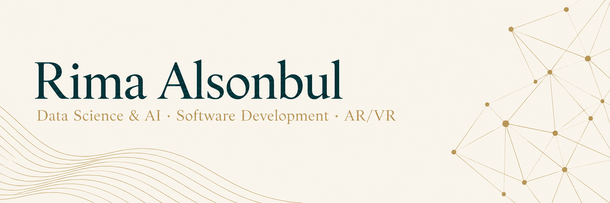

  

  <a href="https://www.linkedin.com/in/rima-alsonbul-55b90424b/">LinkedIn</a>
  &nbsp;·&nbsp;
  <a href="mailto:rikhmoso1425@gmail.com">Email</a>

Information Technology graduate from **King Saud University**, with **First Class Honors**. My interests include computer vision, NLP, and spatial computing.

## Selected Projects

- **Madar** — Indoor navigation with interactive 3D maps, AR guidance, and A*-based routing across multiple floors. Built with Flutter and Firebase.
- **RAGBAN** — A Saudi-inspired 3D puzzle game with instant Past/Present switching and interconnected environmental puzzles. Built with Unity and C#.
- **Traffic Density Classifier** — Evaluated CNN and ResNet-50 models on 4,054 labeled images. An optimized custom CNN achieved **91.09% accuracy** and **0.90 macro F1** on the test set.

[Book Sales Trend Analysis](https://github.com/rima-15/DataScience-project) · [Wefaq](https://github.com/rima-15/Wefaq-project)

## Research

**[Wisdom in Unity: The Role of Multilingual Training in Figurative Language Identification in Proverbs](https://arxiv.org/abs/2608.08090)**  
Co-authored research on multilingual figurative language identification across seven languages. To appear at **MRL, EMNLP 2026**.

## Skills

**Languages:** Python · C# · Java · Dart · SQL · PHP  
**Frameworks & Tools:** Flutter · Unity · Firebase · MySQL · WebXR · Git · Blender
